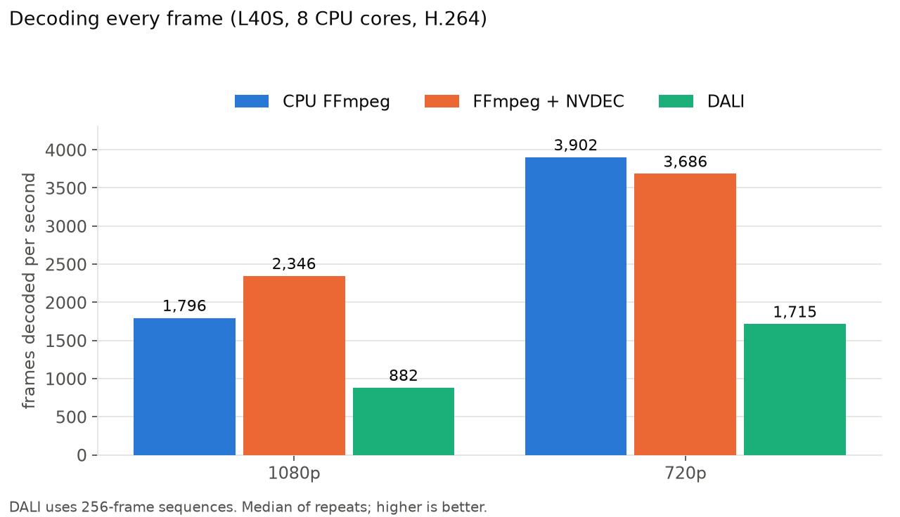

# NVIDIA DALI: End-to-End Tutorial

Companion code for the blog post [`blog.md`](blog.md): fast GPU data loading with NVIDIA DALI, covering images, video, PyTorch training, and benchmarking.

> Requires Linux + NVIDIA GPU. `pip install -r code/requirements.txt`

| File | What it shows |
|---|---|
| `code/step1_first_pipeline.py` | First pipeline: read → GPU decode → resize |
| `code/step2_augmentations.py` | Train/val augmentation pipelines |
| `code/train_dali.py` | End-to-end ResNet-50 training (single/multi-GPU) |
| `code/step5_external_source.py` | Custom data sources (CSV) |
| `code/step6_benchmark.py` | Quick DataLoader vs DALI comparison |
| `code/step7_advanced.py` | Conditionals, RandAugment, debug mode |
| `code/step8_video.py` | Video ingestion and action recognition training |
| `code/benchmark.py` | Full image/video benchmark suite |
| `code/decode_all_frames.py` | Decode every frame: CPU FFmpeg vs FFmpeg+NVDEC vs DALI |
| `code/plot_results.py` | Plot benchmark results |
| `code/plot_decode.py` | Charts for the decode-all-frames comparison |

## Results (NVIDIA L40S, 8 CPU cores, DALI 2.4.0, PyTorch 2.8.0)

| Workload | PyTorch | DALI | Speedup |
|---|---|---|---|
| Images, loading only (8 workers) | 2,805 img/s | 19,086 img/s | 6.8× |
| Images, loading only (2 workers) | 952 img/s | 17,781 img/s | 18.7× |
| Images, ResNet-50 training | 1,110 img/s | 1,204 img/s | 1.08× |
| Video, loading only (8 workers) | 96 clips/s | 126 clips/s | 1.3× |
| Video, R(2+1)D-18 training | 62 clips/s | 109 clips/s | 1.8× |

DALI helps most when data loading is the bottleneck. See section 13.6 of the blog for setup and caveats.

**Decoding every frame (9 clips, 19,457 frames, frames/s):**

| | 1080p | 720p |
|---|---|---|
| CPU FFmpeg (8 cores) | 1,796 | 3,902 |
| FFmpeg + NVDEC | 2,346 | 3,686 |
| DALI video reader (256-frame sequences) | 882 | 1,715 |

DALI wins at sampling training clips; FFmpeg+NVDEC wins at full decoding at 1080p, and plain CPU FFmpeg at 720p. See blog section 13.8.
